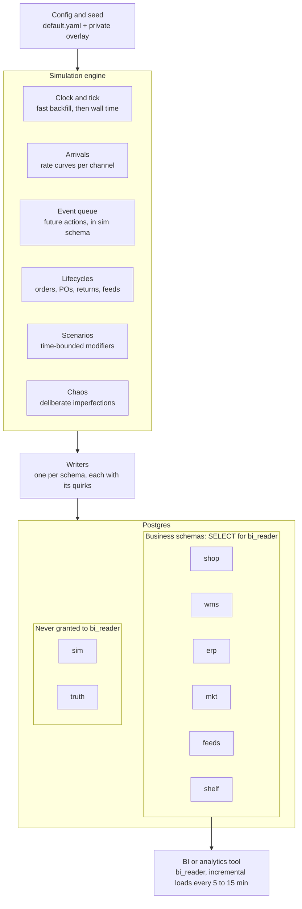
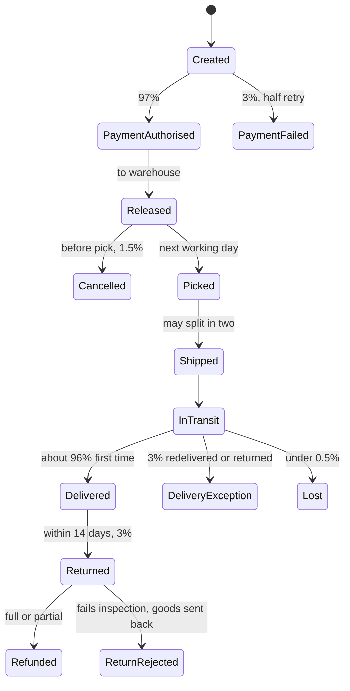

# cpg-commerce-simulator: Specification

Version 1, 14 November 2026. Maintained by Runibex Data & AI.

## Purpose and principles

The simulator produces realistic, continuously changing commerce data for a fictional consumer goods brand, spread across several source systems in plain Postgres. It exists so that analytics, BI and AI platforms (Incorta, Microsoft Fabric, Databricks or anything that reads Postgres) can be evaluated against data that behaves like a real business rather than a static sample.

It is published by Runibex Data & AI as a public repository under `Runibex-Data-AI/cpg-commerce-simulator`. The audience is data teams, partners and prospects who need a credible source to connect a platform to.

Seven principles govern every design choice below:

1. **Business realism over volume.** A brand manufacturer mostly sells to retailers and learns about consumers through feeds. The data reflects that, including sell-in versus sell-out, trade deductions and digital shelf.
2. **Several systems, imperfect keys.** Each source looks like a different system with its own conventions, and joining them takes mapping work, as it does in real life.
3. **One engine for history and live.** The same code backfills the past and runs live, so there is no statistical seam on go-live day.
4. **Deterministic and replayable.** A seed and a config reproduce the same business, so a demo can be reset and replayed.
5. **Built for incremental loads.** Every table can be loaded incrementally by a standard query-based strategy.
6. **Tool-agnostic.** Nothing in the generator depends on a specific platform. Platform-specific setup lives under `examples/`.
7. **Fictional throughout.** Company, brands, retailers, carriers and customers are invented. No real company's figures are implied.

## The fictional business

The simulated company is **Northvale Consumer Care GmbH**, a German skincare manufacturer selling in Germany, Austria and Switzerland through its own web shop, two drugstore chains, a perfumery chain and a marketplace. All names are defaults in config and can be replaced.

**Brands and catalogue.** Three brands share about 180 active SKUs. Velmora is the mass-market body and face care brand and carries most of the volume. Cutara is a dermocosmetic brand with a higher price point and pharmacy-style claims. Sorell is a seasonal sun and lip care brand. Each SKU has a brand, category, line, pack size, EAN, list price, standard cost and launch date. A product hierarchy of brand, category, line and SKU drives seasonality and affinities. Popularity follows a long tail: Roughly 12 hero SKUs carry about half of unit volume.

**Channels.** The shares below are default sell-in value shares, plausible for a brand of this kind but not taken from market data. They are config values.

| Channel | Fictional name | Type | Data the brand receives | Default share |
| --- | --- | --- | --- | --- |
| Drugstore chain A | Drogerie Kranz | Retailer, stores and online shop | POs by EDI, deliveries, invoices, deductions (promotion, advertising fee per promotion, shortage, service penalty), weekly sell-out | 35% |
| Drugstore chain B | Mylo Drogeriemarkt | Retailer, stores and online shop | Same as chain A, different article numbers and feed layout | 25% |
| Marketplace | Shopnova | Marketplace, brand sells wholesale (1P) | POs, invoices, deductions (promotion, co-op percentage, shortage, service penalty), daily sales, traffic and inventory reports | 20% |
| Perfumery chain | Parfümerie Belle | Retailer, mainly Cutara | POs, invoices, deductions (promotion, advertising percentage, shortage), monthly sell-out (retail months) | 10% |
| Own web shop | velmora-shop | Direct to consumer, DE, AT, CH | Full order, customer, payment and shipment detail | 10% |

**Geography and currency.** Consumers and retailer stores are spread across real German, Austrian and Swiss postcodes, weighted by population. Swiss web orders are in CHF, all others in EUR. The ERP reports in EUR at a monthly rate.

**Operations.** One central warehouse ships web orders and retailer deliveries. Three fictional carriers deliver web parcels with different speed and reliability by region: Paketblitz, Nordpost and Swiftbox. Retailer deliveries go by pallet freight to five drugstore distribution centres, two marketplace fulfilment centres and two perfumery warehouses.

## Source systems and schemas

Six Postgres schemas stand in for six systems the brand would really run, each with its own conventions. Two more schemas hold the simulator's internal state and its ground truth, and are never granted to BI tools.

| Schema | Stands in for | Main tables | Conventions |
| --- | --- | --- | --- |
| `shop` | Web shop platform | customers, addresses, orders, order_lines, payments, refunds, promotions, promo_redemptions, subscriptions | UUID keys, English snake_case, `timestamptz` in UTC, statuses as words |
| `wms` | Warehouse and shipping | shipments, shipment_lines, carrier_events, returns, return_lines, stock_levels_daily, stock_movements | Integer keys, two-letter status codes, local Berlin time without timezone |
| `erp` | ERP finance and sales | materials, customers, customer_materials, sales_doc_header, sales_doc_item, delivery_header, delivery_item, billing_header, billing_item, price_conditions, standard_costs, credit_memos, deductions, trade promotion agreements | Ten-digit document numbers, header and item structure, amounts in document currency plus EUR, SAP-style naming (see below) |
| `mkt` | Marketing stack | campaigns, campaign_spend_daily, sessions_daily, attributions, influencer_codes | Text keys, dates rather than timestamps |
| `feeds` | Retailer and marketplace data feeds | retailer_sellout, marketplace_sales_daily, marketplace_inventory_daily, feed_loads | Flat file-like rows, retailer article numbers, a load id per delivery, insert-only; sell-out carries the region's period-end stock, the marketplace report its traffic (`glance_views`) |
| `shelf` | Digital shelf monitoring service | digital_shelf_daily | One row per SKU, retailer site and day: price, in stock, rating, reviews, search rank, content score |
| `sim` | Simulator internals | clock, event_queue, entity_state, run_log | Not granted to BI tools |
| `truth` | Ground truth for planted scenarios | scenario_windows, planted_effects | Not granted to BI tools |

**How the keys line up, and where they don't.** The shop order UUID reaches the ERP only as a free-text external reference on the sales document, and about 1% of those are truncated or missing. The warehouse references the ERP delivery number, never the shop order. Retailers report their own article numbers, mapped to EANs through `erp.customer_materials`, which is about 95% complete. The missing customer-material records are master-data gaps, not lost information: the ERP converted the retailers' EDI orders through the EAN and kept the retailer article on the order line (`vbap.kdmat` next to `matnr`), and the brand's promotion agreements list it too, so a platform can recover the missing mapping from the order history. Feeds and deduction claim items carry only the retailer article (claim items without a mapping have no material). The marketplace uses its own product code, mapped the same way. Both the missing or truncated references and the unmapped articles are data quality defects whose rates are config (see Data quality noise). Web customers are individuals in `shop` but appear in the ERP as one collective account per country. None of this is broken data: It is how these systems usually relate, and joining them is part of what a platform is being tested on.

**ERP flavour.** From phase 1 the `erp` schema uses SAP-style naming, because SAP is the ERP that most large consumer goods manufacturers run and the shape that analytics platforms most often ship ready-made content for. Tables are modelled on the SAP SD and master data tables (sales documents on VBAK and VBAP, deliveries on LIKP and LIPS, billing on VBRK and VBRP, materials on MARA, customers on KNA1, customer materials on KNMT, pricing on KONV) with SAP field names such as `vbeln`, `posnr`, `matnr`, `kunnr`, `erdat` and `netwr`. It is a plausible imitation of the structure, not a full replica of SAP. The descriptive table names in the table above map one to one onto these. A readable English naming profile for `erp`, switched in config, is a phase 3 item.

## Simulation engine

The engine is a discrete-event simulation with its own clock, run as a single Python process. It has two modes that share every line of business logic.



Config drives one engine; writers turn its domain events into rows in six business schemas, and BI tools read only those through `bi_reader`.

**Backfill mode** starts the clock 24 months in the past (configurable) and advances it as fast as the machine allows, writing rows with historical timestamps through bulk `COPY` in batches. It runs once, before any BI tool does its first full load.

**Live mode** keeps the simulation clock equal to wall-clock time and runs indefinitely. It never runs ahead of real time, because future-dated rows would break incremental loads and confuse dashboards. Spikes for a demo come from scenarios, not from speeding up the clock.

**The tick.** Every tick (default 30 seconds live, 1 simulated hour in backfill) the engine does three things in order. It generates new arrivals for the elapsed slice from rate curves: Web orders, retailer purchase orders, sessions, feed deliveries. It processes every event in `sim.event_queue` that is now due, such as "ship order 4711" or "customer 1882 runs out of lotion". Each processed event can schedule further events. Finally it commits all writes for the tick in one transaction per schema.

**Restart safety.** The clock, the queue and per-entity state live in the `sim` schema, so the process can be killed or the machine rebooted and the simulation resumes from the last committed tick. Missed time after a restart is caught up at backfill speed, then live mode continues.

**Determinism.** Randomness is derived per entity and event from the seed (a hash of seed, entity id and event type), not from one global random stream. The same seed and config therefore produce the same business regardless of tick length or restarts, which makes replay before a meeting reliable.

**Writers.** Each schema has a writer module that owns its tables, conventions and quirks (key style, time zone, status codes). Business logic never writes SQL directly: It emits domain events, and the writers translate them into each system's rows. This keeps the cross-system inconsistencies deliberate and in one place.

## Lifecycles

Every business document is a state machine: It is created once and then updated as it moves through states, with a realistic delay before each step. These updates, not just new inserts, are what incremental loads must pick up.

**Web order.** Created, then payment authorised (default 97%) or failed (3%, of which half retry within an hour). About 1.5% are cancelled by the customer before picking. Authorised orders are released to the warehouse, picked and shipped, usually the next working day. If a line is out of stock, the order ships partially and the rest follows as a second shipment or is cancelled. In transit, about 96% are delivered first time, 3% hit a delivery exception (redelivered or returned to sender) and under 0.5% are lost. Delivered orders can be returned within the 14-day withdrawal period, triggering a full or partial refund. The ERP raises the invoice at shipment and a credit memo at refund.



Every transition is an update to the same order row, which is what an incremental load has to catch.

The other lifecycles follow the same pattern:

| Document | States in order | Typical timing (default) | Systems touched |
| --- | --- | --- | --- |
| Retailer purchase order | received by EDI, confirmed (with cuts if stock is short), delivery planned, shipped to DC, proof of delivery, invoiced, paid net of deductions | Weekly per DC; delivery in 2 to 4 days; payment at 30 to 60 days | erp, wms |
| Marketplace purchase order | received, confirmed or partially rejected, shipped, received at marketplace warehouse, invoiced, paid | Several per week; payment at 60 days | erp, wms, feeds |
| Trade deduction | claimed by retailer, matched to promotion or disputed, accepted or reversed (an over-agreement dispute settles at the amount the agreement and the sell-out feed prove), taken by short payment (split across invoices if larger than one), unaccepted part repaid | Claimed 2 to 8 weeks after the promotion; disputes take weeks | erp |
| Return (web) | requested, label issued, received at warehouse, inspected, refunded or rejected | Received 3 to 10 days after request | shop, wms, erp |
| Subscription | created, active (repeating orders), paused, cancelled | Interval 4, 8 or 12 weeks | shop |
| Retailer sell-out | delivered weekly (the perfumery per retail month of a 4-4-5 calendar of ISO weeks, the marketplace daily), sometimes restated with the next delivery | Monday after the sales week; the perfumery on the Wednesday after the retail month; 3% of retailer files arrive one or two days late | feeds |

Corrections are part of the lifecycle too. A status set in error is overwritten hours later, which changes `updated_at` on the existing row; the correction keeps the error timestamp (`cancelled_at` on a shop order that is not cancelled, `cancelled_local` on a shipment that is not `CX`), as when a status is reverted by hand. A restated feed period arrives as a new load whose rows replace the earlier load's rows for that period; feed rows are never updated.

## Demand and behaviour models

Demand is generated bottom-up, from consumers and retailers behaving plausibly, not by drawing daily totals. All parameters below are config defaults chosen to look credible. They are not market data and should be presented as synthetic.

**Arrivals.** New web orders follow a non-homogeneous Poisson process. Its rate multiplies a base rate (default 300 orders a day) by an hour-of-day curve (evening peak around 20:00, trough at 04:00), a day-of-week factor (Sunday and Monday highest), annual seasonality per category, event multipliers and active scenario modifiers.

**Seasonality and events.** Sun care peaks May to August. Lip care and rich creams peak November to February. Gift sets sell almost only in November and December. Black Friday week lifts web demand about 2.5 times, the run-up to Christmas about 1.6 times, and a marketplace sale event in July about 3 times on the marketplace only. Mother's Day lifts Cutara.

**Promotions.** A promotion lifts the promoted SKUs' demand by a price-elasticity curve (default elasticity -2.0), pulls some demand forward and is followed by a dip of about 30% of the lift over the next three weeks. Retailer promotions also raise that retailer's purchase orders two weeks earlier and create trade deductions afterwards.

**Customers.** New web customers arrive by acquisition channel (organic search, paid search, social, influencer codes, marketplace spillover), with volume driven by `mkt` spend. Each purchase schedules a repurchase intent when the product would run out, drawn from a gamma distribution around the pack size's usage time (a 400 ml body lotion about 60 days). Each intent converts with a probability that decays with the number of intents missed, so customers lapse naturally. About 8% of repeat customers take a subscription.

**Baskets.** Basket size is 1 plus a Poisson draw (mean 1.4). Lines are picked by SKU popularity, then adjusted by affinity pairs (cleanser with moisturiser, sun cream with after-sun). A free-shipping threshold (default EUR 29) makes basket values bunch just above it.

**Payments.** Defaults for Germany: PayPal 38%, invoice or buy-now-pay-later 27%, card 20%, direct debit 10%, other 5%. Austria and Switzerland shift somewhat towards card.

**Delays.** Every lifecycle delay is drawn from a log-normal distribution with a per-carrier, per-region median, plus weekend and public-holiday gaps (German, Austrian and Swiss calendars).

**Returns.** Default web return rate 3%, far below fashion. Reasons are damaged in transit, wrong item, did not like it, and allergic reaction (Cutara only, low rate).

**Retailers.** Each retailer has hidden consumer demand per SKU and store region, driven by the same seasonality, promotions and digital-shelf effects. Its purchase orders come from that demand plus forecast error, safety stock and order cycles, so sell-in and sell-out diverge week to week and converge over a quarter. A store region is the sales region served by one retailer distribution centre (there are no individual stores). Sell-out is split into store and online.

**Digital shelf.** Daily price and availability come from retailer stock and promotions. Ratings drift slowly and react to returns and allergic-reaction rates. Search rank moves with sales velocity and content score.

## Planted scenarios and ground truth

Scenarios are time-bounded modifiers on model parameters, switched on in config or live from the CLI. Each one plants a business story that a platform should be able to surface by joining sources, and each records exactly what it did in the `truth` schema so findings can be checked afterwards.

| Scenario id | The story | Mechanism | Where it shows | Sources to join |
| --- | --- | --- | --- | --- |
| `carrier_decay` | One carrier quietly gets worse in one region | Delay median ×2.5 and exception rate ×3 for Swiftbox in Bavaria from a set week | Late deliveries, exceptions, refunds, ratings | shop, wms, erp |
| `promo_margin_trap` | A promotion grows volume but loses money | 25% off plus free shipping on Velmora; baskets fall below break-even once shipping and returns are costed | Orders up, contribution margin negative | shop, wms, erp, mkt |
| `hero_oos_substitution` | A hero SKU runs out and a sibling absorbs part of the demand | A quality block puts the central stock of one hero SKU on hold for three weeks (then recalled); 40% of its demand moves to the nearest sibling, the rest is lost | Stock-outs, retailer order cuts, sell-out dip at one or more retailers, shelf shows out of stock¹ | wms, feeds, shelf¹, erp |
| `influencer_cohort_churn` | A campaign buys customers who never come back | Customers acquired by one influencer code during the window have repurchase probability ×0.3 for life, while the code's campaign budgets rise 2.5 times (`mkt.campaigns.daily_budget_eur` is raised for the window; truth records every boosted campaign) | Cohort retention curve, CAC versus lifetime value | shop, mkt |
| `retailer_overstock` | Sell-in runs ahead of sell-out at one chain | Mylo orders 30% above its demand for a quarter, then cuts orders and claims extra deductions | Sell-in versus sell-out gap, rising retailer stock, clearance deductions | erp, feeds |

¹ The digital shelf arrives in phase 3; until then the hero stock-out and `carrier_decay` show in wms, feeds and erp, not in shelf ratings or availability.

**Ground truth.** `truth.scenario_windows` records each scenario's id, parameters, start and end. `truth.planted_effects` records the affected entities (orders, customers, SKUs, weeks) with the size of the modification. Neither table is granted to the BI reader role.

**Live triggering.** `sim scenario enable <id>` starts a scenario from the current moment, so its effect appears in a BI tool after the next incremental load. This is the intended way to demonstrate data freshness in a meeting.

**Public versus private scenarios.** The repository ships the generic scenarios above. Scenarios tailored to a specific prospect live in a private overlay file outside the repository (see configuration).

## Data quality noise

A chaos module adds the imperfections every real estate has, at low, configurable rates, so that a platform's modelling and cleansing are tested too. Noise never breaks referential integrity inside a single system. It lives in how systems disagree and in what people get wrong.

| Defect | Default rate | Where |
| --- | --- | --- |
| Duplicate customer records (same person, slightly different name or email) | 2% of web customers | shop |
| Missing or malformed postcode | 0.5% of addresses | shop |
| Status set in error, corrected hours later (the error timestamp stays) | 0.3% of orders | shop, wms |
| Duplicate carrier events | 1% of events | wms |
| Local time without timezone across a DST change (one truth row per transition) | Inherent to the schema | wms |
| Missing or truncated shop order reference on ERP sales documents | 1% | erp |
| Retailer article numbers with no customer-material record (recoverable from EDI order history) | 5% of retailer articles | erp, feeds |
| Sell-out restated with the next delivery | 10% of retailer periods (weeks, retail months) | feeds |
| Free-text return reasons alongside the coded reason | 15% of returns | wms |
| GDPR erasure: customer personal data anonymised on request, orders kept | About 0.05% of customers a month | shop (the warehouse keeps the consignee name) |

Every noise event is also written to `truth.planted_effects`, and each defect has a `truth.scenario_windows` row (`<defect>:chaos`), so data quality findings can be checked the same way as business findings. Every rate is config; 0 switches a defect off.

## Loading contract for BI tools

Any tool with a Postgres connector and a query-based incremental strategy can load every business table without custom logic. The contract below is what the generator guarantees.

1. **Keys.** Every table has a primary key. Composite keys are allowed for item tables (header id plus line number).
2. **Change tracking.** Every table has `created_at` and `updated_at`, and `updated_at` changes on every update to the row. The backfill sets both from the simulation clock; in live mode (including the catch-up after downtime) they carry the commit time, so a watermark on `max(updated_at)` catches every change. Each `updated_at` column is indexed.
3. **No hard deletes.** Business rows are never deleted. Cancellations are states, erasures are anonymisation updates, and anything withdrawn carries `is_deleted` and `deleted_at`. Query-based incremental loads cannot see deletes, so none happen.
4. **Snapshots and feeds are insert-only.** Daily snapshot tables (`wms.stock_levels_daily`, `shelf.digital_shelf_daily`) and the four `feeds` tables only receive new rows. A restatement arrives as a new row with a new load id, never an update. Load them in full, or append by `load_id`.
5. **Roles.** `sim_writer` owns all schemas and is used only by the generator, over the Compose network (SSL). `bi_reader` has `SELECT` on the six business schemas and nothing else: No access to `sim` or `truth`, no write rights.
6. **Transport.** Postgres listens with SSL required for remote connections. Only the BI tool's outbound IPs should be allowed in.
7. **Freshness.** A change committed in a tick is visible to `bi_reader` at the end of that tick, so the lag a BI tool sees is the tick length plus its own load schedule. A five- to fifteen-minute incremental schedule is the recommended setting.

Query-based incremental loading on `updated_at` is the baseline. Log-based change data capture is possible with tools that support it, but it needs extra infrastructure (for example Debezium and Kafka) and is out of scope for the generator.

`examples/` holds platform-specific notes for each tool, starting with Incorta (connector settings, incremental load query per table, suggested load schedule).

## Configuration and CLI

One YAML file describes the business, validated at start-up with pydantic. An optional overlay file, passed by path, is merged on top and is where private, prospect-specific settings live.

```yaml
seed: 20261114
history_months: 24
tick_seconds: 30
company:
  name: Northvale Consumer Care GmbH
  brands: [Velmora, Cutara, Sorell]
  catalogue_size: 180
channels:
  web:            { base_orders_per_day: 300, free_shipping_eur: 29 }
  drogerie_kranz: { share: 0.35, order_cycle_days: 7, dcs: 3 }
  mylo:           { share: 0.25, order_cycle_days: 7, dcs: 2 }
  shopnova:       { share: 0.20, model: 1p }
  belle:          { share: 0.10, sellout_frequency: monthly }
erp:
  naming: sap
seasonality:
  black_friday_lift: 2.5
  christmas_lift: 1.6
scenarios:
  - id: carrier_decay
    carrier: Swiftbox
    region: DE-BY
    start: 2026-08-03
    delay_multiplier: 2.5
chaos:
  duplicate_customer_rate: 0.02
  sellout_restatement_rate: 0.10
```

The command-line tool is `sim`:

| Command | What it does |
| --- | --- |
| `sim init` | Creates schemas, tables, indexes and the two roles |
| `sim reset --seed N` | Drops all simulated data and the clock, keeps the structure |
| `sim backfill --months 24` | Runs backfill mode up to now |
| `sim run` | Runs live mode until stopped; catches up first if behind |
| `sim status` | Shows clock, queue depth, rows written per schema in the last hour, active scenarios |
| `sim scenario list / enable <id> / disable <id>` | Lists scenarios or switches one on or off from now |
| `sim truth <scenario or defect id>` | Prints what a scenario or data quality defect planted, for checking findings |

The stack is Python 3.12 with numpy, Faker (German, Austrian and Swiss locales), psycopg 3 and pydantic.

## Repository layout and deployment

The repository contains the generator and everything needed to run it on any machine with Docker, and nothing about any particular deployment.

```
cpg-commerce-simulator/
  README.md
  LICENSE
  docker-compose.yml        # postgres + generator, restart: unless-stopped
  .env.example              # placeholders only; .env is gitignored
  config/
    default.yaml
    scenarios/              # generic scenarios shipped publicly
  sql/
    schemas/                # one file per schema
    roles.sql               # sim_writer, bi_reader
  src/cpgsim/
    engine/                 # clock, event queue, tick loop, determinism
    domain/                 # catalogue, customers, channels, lifecycles
    models/                 # demand, seasonality, delays, baskets
    scenarios/
    chaos/
    writers/                # one module per schema
    cli.py
  tests/
  examples/
    incorta/
  docs/
    SPEC.md                 # this document
    deploy-on-a-vm.md       # generic, placeholders only
```

**Running it.** `docker compose up` starts Postgres and the generator. On first start the generator runs `init` and `backfill`, then `run`. The generator reaches Postgres over the Compose network, and only port 5432 is published. A small VM with 2 vCPU, 2 GB RAM and a 50 GB disk is enough for the default volume.

**Sizing.** Measured at the default 300 web orders a day with all five channels (phase 2). The 24-month backfill writes about 10.4 million business rows (erp 5.1 million, wms 3.2 million, shop 1.5 million, feeds 0.3 million, mkt 0.3 million), and the database comes to 3.3 GB including indexes (business schemas 3.0 GB, simulator state 0.25 GB, truth 0.03 GB). Postgres also keeps up to 2 GB of WAL (`max_wal_size`), so the data directory is about 5.5 GB. With the Compose stack limited to 2 vCPU and 2 GB RAM without swap (Postgres 1.2 CPU and 1280 MB, generator 0.8 CPU and 768 MB), the phase-1 backfill took 13 minutes on a laptop, with peak memory of 380 MB for the generator and 460 MB for Postgres (page cache not counted) and no OOM kill. The phase-2 backfill takes 1.1 to 1.15 times as long as phase 1 on the same development machine (10.3 and 10.9 minutes in two runs against 9.5) with a generator peak of 430 to 440 MB, so about 15 minutes are expected on that stack; a VM with slower disks takes longer. Live mode then adds about 13,000 rows a day in an ordinary month and 14,600 a day averaged over a year with its seasonal peaks, about 1.6 GB a year. A 50 GB disk therefore leaves room for many years of live running, Postgres overhead and Docker images.

**Public-repository rules.**

- Only fictional names for companies, brands, retailers, carriers and people.
- No infrastructure details: No hosts, IPs, security groups, keys or real `.env` values.
- No prospect-specific scenarios or settings. Those go in an overlay file kept outside the repository, passed with `--overlay /path/to/private.yaml`.
- Platform names appear only in `examples/`, in the README's compatibility list and as examples in this specification.
- Licence: Apache-2.0.

## Phasing and acceptance criteria

The build runs in three phases, each ending in something that can be connected to a BI tool and shown.

| Phase | Scope | Done when |
| --- | --- | --- |
| 1. Core loop | Engine (clock, queue, determinism, restart safety); `shop`, `wms`, `erp` with SAP-style naming; web channel and the two drugstore chains' sell-in; seasonality, promotions, customer repurchase; `carrier_decay` and `promo_margin_trap`; loading contract; Compose stack and CLI | Backfill of 24 months completes on a 2 GB VM in under an hour; live mode runs 72 hours without errors; same seed gives identical row counts and totals; a BI tool loads every table incrementally on a 15-minute schedule |
| 2. Retail reality | `feeds` (sell-out, restatements), marketplace and perfumery channels, deductions, `mkt`; the remaining three scenarios; chaos module; `truth` schema | Sell-in and sell-out for each retailer converge within 5% over a quarter outside scenario windows²; every scenario and noise type is recorded in `truth` and visible in the data |
| 3. Polish and reach | `shelf` (digital shelf); readable English naming profile for `erp`; `examples/incorta` with tested settings; `docs/deploy-on-a-vm.md`; README with screenshots | A newcomer goes from clone to a connected BI tool in under 30 minutes using only the README |

² Measured in units per retailer and retail quarter (13 ISO weeks: Q1 = weeks 1-13, Q4 = weeks 40-52 or 53). Sell-in is the delivered quantity of the retailer's purchase orders received in the quarter's weeks; sell-out is the quarter's feed periods, taking the latest load per period. A quarter is checked unless it is partial or the first full quarter of history, it overlaps a retail-affecting scenario span (`hero_oos_substitution` for every retailer until its recovery ends, `retailer_overstock` for its retailer until its cut phase ends), or one of its periods still awaits a restatement. Each retailer needs at least three checked quarters, among them a Q3 and a Q4. Convergence holds by construction, not by seed: the fast test runs five seeds through 2026 Q3 and asserts every checked quarter within 4 %, and the acceptance run checks the default data through 2026 Q3. Retailer promotion weeks lie in weeks 3 to 12 of the retail quarter, so a forward buy and its promotion fall in the same quarter; what remains is the seasonal stock swing (sun care), about 1-3.5 % at the perfumery.

Tests cover the determinism guarantee, the loading contract (every table has the key and timestamp columns, no deletes), and statistical sanity checks on generated distributions (seasonal peaks in the right months, return rate within tolerance).

## Decisions

| Decision | Choice |
| --- | --- |
| Default web volume | 300 orders a day, configurable |
| ERP naming | SAP-style from phase 1; readable English profile in phase 3 |
| Licence | Apache-2.0 |
| Incremental strategy | Query-based on `updated_at`; log-based CDC out of scope |
| Live tick | 30 seconds |
| Reference disk size | 50 GB |
| Trade deductions in billing | Phase 2 books no credit memos for accepted deductions: they are short-paid from invoices and recorded as clearing items (`erp.zdeduct_clr`), with the accepted funding in `erp.zdeduct.zzaccepted`. Open question to the product owner whether a later phase adds G2 credit memos |
